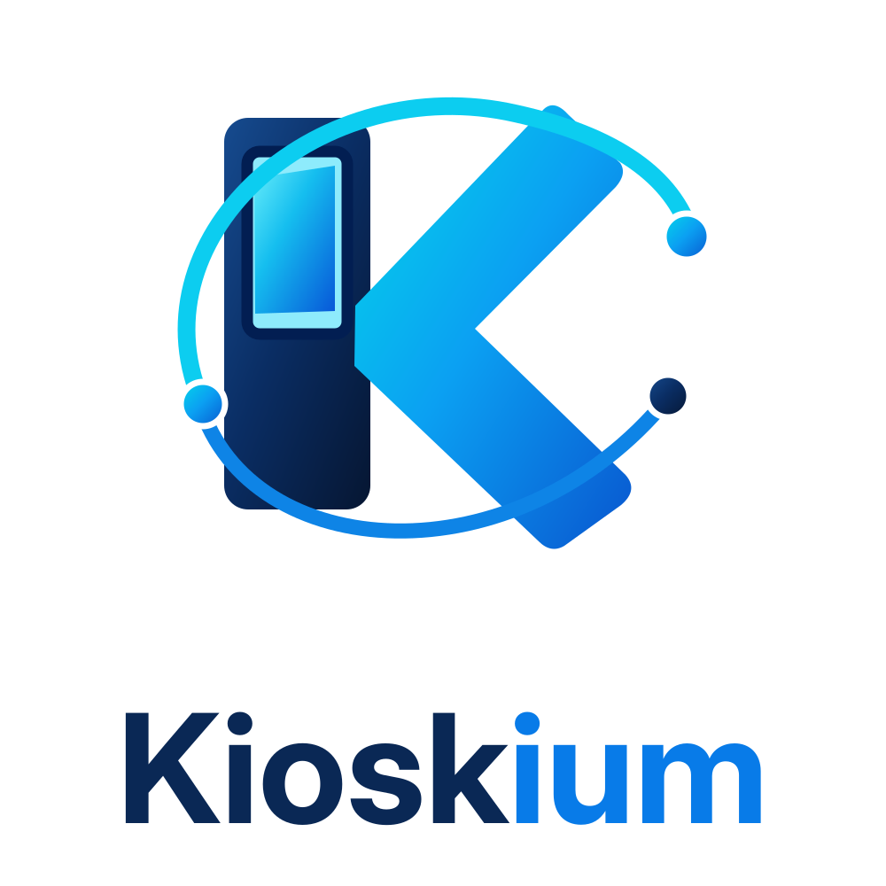
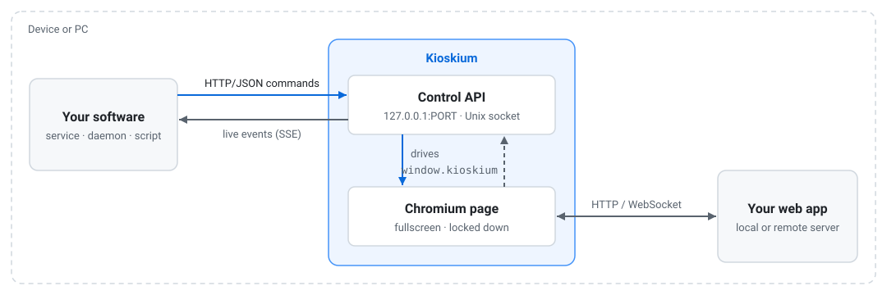

<h1 align="center">
  <picture>
    <source media="(prefers-color-scheme: dark)" srcset="docs/images/kioskium-dark.svg">
    
  </picture>
</h1>

<p align="center">
  <a href="https://github.com/jerhemy/kioskium/actions/workflows/release.yml"></a>
  <a href="https://github.com/jerhemy/kioskium/releases"></a>
  <a href="LICENSE"></a>
</p>

**A kiosk-mode web browser that your software controls.** Kioskium turns a screen into a single
web page (no browser UI, no way out, GPU rendering) and gives the programs around it a local
HTTP/JSON API to drive it: navigate, reload, split the screen, run JavaScript, take screenshots,
open DevTools and follow a live event stream.

It is built on Qt WebEngine (Chromium) through PySide6 and runs on **Windows** and **Linux**:
desktop, and embedded Wayland/Yocto boards such as i.MX8. Prebuilt bundles include their own
Python, Qt and Chromium, so you unpack them and run.

## Why Kioskium

The first spark for Kioskium was wanting to run a web-based kiosk on a Raspberry Pi. A normal
browser in kiosk mode got me most of the way there, but I kept running into the limits it imposed
on me.

Then, working on another project, I ran into the same problem again, only more limited, because
there I had to use [qtwebbrowser](https://code.qt.io/cgit/qt-apps/qtwebbrowser.git/), Qt's demo
browser that many embedded Linux images use as their kiosk. It was a good solution as a demo, but a
bad fit as the primary UI of a product:

- **Limited support as primary UI.** It is built on Qt5's WebEngine (Chromium 87) with no
loading screen when the backend isn't up yet, no crash recovery, and little control over
how it can lockdown the page.
- **No control mechanism.** Once running, nothing else on the device could tell it what to
show. To change the page, it had to be restarted.

The alternative to that was embedding a web view within the application itself, which
tied the UI toolkit, the Chromium build and the GPU stack to the applications process and
release cycle, a heavy price to pay for displaying a web page.

Those two projects are what led to Kioskium. What I wanted was a kiosk browser that fits into my
software without being part of it:
a separate process that owns the screen, which my software can manipulate over a small,
stable API. Kioskium does that. The web app retains all benefits of being a web app (any
framework, hot updates from the server, devtools), while the software on the device has full
control over which page is being shown, when it needs to reload, if the screen needs to be split,
what the page is doing, and when to quit.

## Features

- **Kiosk lock-down by default.** Frameless fullscreen with the pointer hidden, and no context menu, text selection,
  popups, dialogs, downloads, pinch zoom, navigation keys or Alt+F4. `window.close()` is ignored.
- **Resilient.** A loading screen replaces Chromium's error page and retries with backoff until the
  app is reachable. Renderer crashes reload the page, and a load that hangs is retried after 30 s. Optional periodic reload.
- **Start without a URL.** With no URL, the loading screen waits until your software sends one, so the
  screen looks right from boot. `navigate kioskium:idle` puts it back into waiting.
- **Remote control.** HTTP/JSON API, a `kioskctl` CLI and a live event stream, plus an instance
  registry and a `/api/health` endpoint for monitors. Starting a name that already runs hands it the
  new URL instead of opening a second browser.
- **Supervised.** An optional daemon (`kioskctl serve`) opens browsers over REST, restarts crashed ones
  and starts the configured ones at boot; `kioskctl` uses it automatically when it runs.
- **Screen targeting.** Sets the Wayland `app_id` so the compositor puts each instance on the right
  output (`--list-app-ids` reads `weston.ini`); `--screen` on other platforms.
- **Touch-first.** Touch events, and a pointer that stays hidden for touch but can appear while a
  mouse moves (handy over remote desktop).
- **Split screen.** Two pages side by side or stacked, at start-up or at runtime.
- **Debuggable in the field.** In-window DevTools (even in kiosk mode), a frame-rate overlay, a
  built-in diagnostics page (`kioskium:test`) and rotating logs of both the browser and the page's
  console and JavaScript errors.
- **GPU accelerated.** Hardware rendering on desktop GPUs and on GLES-only embedded GPUs (OpenGL ES
  is selected automatically on Linux arm boards).
- **Configurable.** Kiosk-first defaults with flags to relax them for testing, a JSON config file and
  environment variables.

## Quick start

**Prebuilt.** Download from [Releases](https://github.com/jerhemy/kioskium/releases):

| Archive | For |
|---|---|
| `kioskium-X.Y.Z-windows-x86_64.zip` | Windows 10/11 |
| `kioskium-X.Y.Z-linux-x86_64.tar.gz` | desktop Linux with glibc ≥ 2.39 (Ubuntu 24.04+) |
| `kioskium-X.Y.Z-linux-arm64.tar.gz` | arm64 boards/devices with glibc ≥ 2.31 (Yocto hardknott+, Debian 11+, Ubuntu 20.04+) |

```sh
tar -xzf kioskium-*-linux-arm64.tar.gz
./kiosk/kiosk --windowed kioskium:test            # a normal window with the diagnostics page
./kiosk/kiosk --windowed https://example.com     # your own page in a normal window
./kiosk/kiosk https://example.com                # kiosk: fullscreen, locked down
```

On Windows, unzip and run `kiosk\kiosk.exe --windowed kioskium:test` or `kiosk\kiosk.exe https://example.com`. Keep the folder together; the
executables need the libraries and data files next to them.

**From source** (Python 3.9+):

```sh
pip install "kioskium @ git+https://github.com/jerhemy/kioskium"
kiosk --windowed kioskium:test
kioskctl list
```

To leave a kiosk window, run `kioskctl close --all`, start it with `--exit-shortcut Ctrl+Shift+Q`, or
end the process. During development, `--windowed` gives you a normal window.

## How it fits with your software

<picture>
  <source media="(prefers-color-scheme: dark)" srcset="docs/images/architecture-dark.svg">
  
</picture>

- Your software starts Kioskium (as a child process, with `kioskctl open`, or through the daemon's
  REST API) with a control port, then talks to it over HTTP. Any language with an HTTP client
  works; there is nothing to link against.
- The web app talks to its own backend as usual. It can also call `window.kioskium` for a few
  browser-level actions (split, DevTools, reload).
- The control API listens on **127.0.0.1 only** (or a Unix socket with user-only permissions), so
  it is not reachable from the network. Add `--control-token` to require a shared secret, and use an
  SSH tunnel to reach it from another machine.

### Start first, choose the page later

Kioskium doesn't need a URL at start-up. Without one it shows the loading screen and waits, so the
screen looks right from boot while your software decides what to show:

```sh
kioskctl open                                     # loading screen, waiting
kioskctl navigate http://localhost:8080/          # show the app
kioskctl navigate kioskium:idle                   # back to the loading screen
```

`GET /api/status` reports `"state": "idle"` while it waits.

### Built-in pages

These addresses work anywhere a URL does: on the command line, with `kioskctl navigate` and
`split`, through the control API and from `window.kioskium.split()`. The pages ship inside the
bundle, so they work offline.

| Address | Page |
|---|---|
| `kioskium:idle` | the loading screen with nothing to load; waits until a URL is sent (the default without a URL) |
| `kioskium:test` | diagnostics: WebGL rendering, frame rate, display and input, versions, kiosk lock-down checks and browser controls |
| `kioskium:input` | form fields and the input events they produce (for trying a device's keyboard) |

```sh
kiosk --windowed kioskium:test                                       # check a new device
kioskctl split kioskium:input --ratio 55          # input test next to the app
```

## Controlling it

Every browser has a control API (`kioskctl -n NAME` finds it); start one with `--control-port 7001` for
a fixed port and send it JSON over HTTP.
Every response has `"ok": true|false`; failures add `"error"`.

| Method | Endpoint | Body | Does |
|---|---|---|---|
| GET | `/api/health` | | `{ok, state}` for monitors; no token needed |
| GET | `/api/status` | | state of the browser |
| POST | `/api/navigate` | `{"url", "pane"?}` | load a page (`pane` 2 = second pane of a split) |
| POST | `/api/reload` | `{"pane"?}` | reload a pane |
| POST | `/api/split` | `{"url", "orientation"?, "ratio"?}` | add or re-point the second pane |
| POST | `/api/unsplit` | `{}` | remove the second pane |
| POST | `/api/devtools` | `{"action": "open"\|"close"\|"toggle"}` | in-window inspector |
| POST | `/api/fps` | `{"enabled": true\|false\|"toggle"}` | frame-rate overlay |
| POST | `/api/js` | `{"code", "pane"?}` | run JavaScript, return the result as JSON |
| POST | `/api/screenshot` | `{"path"}` | PNG of the window, saved on the device |
| POST | `/api/quit` | `{}` | close the browser cleanly |
| GET | `/api/events[?since=N]` | | live Server-Sent Events stream |

With curl, or wget on minimal images:

```sh
curl -s http://127.0.0.1:7001/api/status
curl -s -d '{"url":"http://localhost:8080/"}' http://127.0.0.1:7001/api/navigate
curl -s -d '{"code":"document.title"}' http://127.0.0.1:7001/api/js
curl -sN http://127.0.0.1:7001/api/events

wget -qO- http://127.0.0.1:7001/api/status
wget -qO- --post-data='{"url":"http://localhost:8080/"}' http://127.0.0.1:7001/api/navigate
```

Or with `kioskctl`, which opens browsers and finds them by name (`-n`, which defaults to the
app-id; with one browser running it can be left out):

```sh
kioskctl open http://localhost:8080/ --app-id left-screen
kioskctl list
kioskctl navigate -n left-screen http://localhost:8080/next
kioskctl js -n left-screen "document.title"
kioskctl --port 7001 status                       # a browser started with --control-port 7001
kioskctl close --all
```

Every command is in [docs/KIOSKCTL.md](docs/KIOSKCTL.md).

### Start browsers over REST

When the software that drives the screens can't run commands, run the daemon. It has one fixed
port, opens, closes and restarts browsers, restarts crashed ones, and forwards their API:

```sh
kioskctl serve                         # http://127.0.0.1:7000/api/
curl -s -d '{"appId":"left-screen","url":"http://localhost:8080/","args":["--loading-status"]}' http://127.0.0.1:7000/api/instances
curl -s -d '{"url":"http://localhost:8080/next"}' http://127.0.0.1:7000/api/instances/left-screen/navigate
curl -s -X DELETE http://127.0.0.1:7000/api/instances/left-screen
```

While it runs, `kioskctl open`, `close`, `restart` and `list` on the same machine go through it. With
`--instances FILE` it opens browsers at start-up; [docs/EMBEDDED.md](docs/EMBEDDED.md#running-the-daemon-with-systemd)
has a systemd unit for it. See
[docs/API.md, section 8](docs/API.md#8-daemon-start-browsers-over-rest-kioskctl-serve).

The page itself can call `window.kioskium` (split, DevTools, reload, frame-rate overlay).
**[docs/API.md](docs/API.md)** has every endpoint with curl and wget examples, the event list,
tokens, Unix sockets, the JavaScript API, the Postman collection and how to reach a device's API
over SSH.

## Typical setups

An embedded touch panel with one browser per screen, where the Wayland compositor maps app-ids to
outputs:

```sh
kiosk --app-id left-screen --control-port 7001 http://localhost:8080/left &
kiosk --app-id right-screen --control-port 7002 http://localhost:8080/right &
```

A signage PC that must survive a backend that boots slower than the screen:

```sh
kiosk --screen 1 --retry-interval 5 --reload-interval 3600 --log-file /var/log/kioskium/sign.log http://cms.local/
```

Installing the bundle on a device and embedded notes are in [docs/EMBEDDED.md](docs/EMBEDDED.md).

## Configuration file

Put the usual flags in JSON so launch lines stay short. Keys are the long option names, and the
command line overrides the file. A `kioskium.json` next to the executable (or in the working
directory) is loaded automatically; otherwise use `--config FILE` or env `KIOSKIUM_CONFIG`.

```json
{
  "show-cursor-timeout": 3,
  "log-file": "/var/log/kioskium/{name}.log",
  "page-log": "/var/log/kioskium/{name}-page.log"
}
```

- `{name}` is the instance name (`--name`, else the app-id), so instances sharing one file write
  separate logs.
- `kiosk --print-config [flags]` prints the effective settings as JSON (a good starting file);
  `--no-config` ignores the file. See [examples/kioskium.json](examples/kioskium.json).
- Arguments can also come from a text file, one per line: `kiosk @/etc/kioskium.conf`. Values
  starting with `-` need the `=` form (`--qt-arg=-plugin`).

## Command line

Defaults without flags: kiosk mode (frameless fullscreen above other windows, the lock-down described
under Features), pointer hidden, touch events on, scrollbars hidden, loading screen with retries and
a 30 s load timeout, crash reload, a control channel found by name (`kioskctl -n NAME`), and
`window.kioskium` available to pages. Starting a name that already runs hands it the new URL.
`SIGTERM` quits, `SIGHUP` reloads. `kiosk --help` lists every option; [docs/OPTIONS.md](docs/OPTIONS.md) explains them by topic.

## More documentation

| | |
|---|---|
| [docs/OPTIONS.md](docs/OPTIONS.md) | every `kiosk` option, by topic |
| [docs/API.md](docs/API.md) | control API with curl/wget examples, `kioskctl`, events, JavaScript API, logs, exit codes |
| [docs/KIOSKCTL.md](docs/KIOSKCTL.md) | every `kioskctl` command and option, including `kioskctl serve`, with examples |
| [docs/EMBEDDED.md](docs/EMBEDDED.md) | installing on a device, Wayland/Weston screen placement, GPU (i.MX and other GLES boards), troubleshooting |
| [CONTRIBUTING.md](CONTRIBUTING.md) | building from source and the bundles, tests, releases |
| [Releases](https://github.com/jerhemy/kioskium/releases) | release history and notes, with the bundles |

## License

Kioskium's own code is [MIT](LICENSE). Its binary releases also bundle Qt and PySide6 (LGPL-3.0)
and Chromium (BSD and others), as unmodified shared libraries.
[licenses/THIRD_PARTY_NOTICES.md](licenses/THIRD_PARTY_NOTICES.md) lists every component, its
license and where to get the source.
